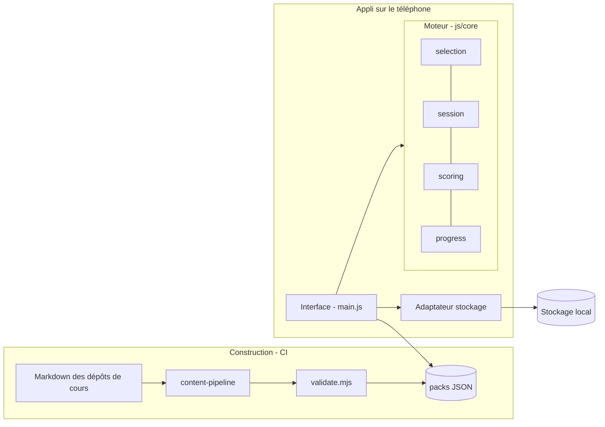
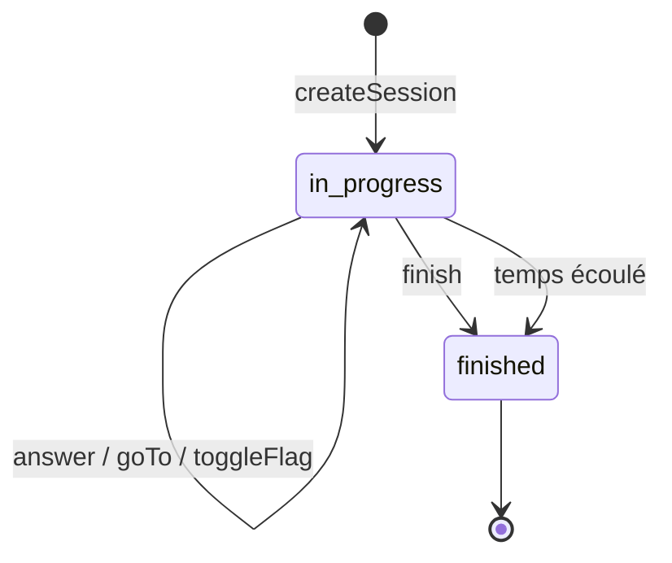

# Phase C — Application Architecture

## Pattern : hexagonal (ports et adaptateurs) + contenu géré comme du code

| Composant | Responsabilité | Dépend de |
| --- | --- | --- |
| `content-pipeline/<pack>/build.mjs` | Lire les Markdown d'un dépôt de cours et produire `questions.json` | Format du dépôt source |
| `content-pipeline/validate.mjs` | Bloquer la publication si un pack est invalide | `pack.json`, `questions.json` |
| `js/core/selection.js` | Stratégies : séquentielle, aléatoire, adaptative, erreurs ; génération selon répartition ; examens figés | `progress`, `random` |
| `js/core/session.js` | Machine à états `in_progress → finished`, chronomètre, mélange des options | `random`, `scoring` |
| `js/core/scoring.js` | Points par option, score de session, seuils ramenés à la taille | — |
| `js/core/progress.js` | Statistiques par question, difficulté mesurée, boîtes de Leitner | — |
| `js/adapters/storage.js` | Port de stockage (localStorage, repli mémoire) | Navigateur |
| `js/main.js` | Vues et actions | Tout ce qui précède |

Le moteur (`js/core`) n'utilise ni le DOM ni le stockage : il est testé en Node (`tests/core.test.mjs`) avec un pack fictif, ce qui prouve son indépendance vis-à-vis de TOGAF.

## Machine à états d'une session

En mode **examen**, la correction n'est visible qu'à l'état `finished`. En mode **entraînement**, elle l'est dès qu'une question a une réponse, et cette réponse est figée.
