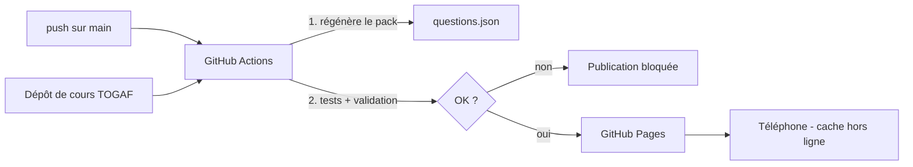

# Phase D — Technology Architecture

| Élément | Choix | Raison |
| --- | --- | --- |
| Client | Navigateur mobile (Chrome Android, Safari iOS) | Rien à installer depuis un store |
| Format | Progressive Web App : `manifest.webmanifest` + `sw.js` | Installable sur l'écran d'accueil, hors ligne |
| Code | HTML, CSS, JavaScript (modules ES), sans framework ni dépendance | Rien à maintenir, chargement rapide |
| Stockage | `localStorage` via un adaptateur | Suffisant pour quelques centaines de Ko par pack |
| Hébergement | GitHub Pages | Gratuit, HTTPS (requis pour le service worker) |
| Intégration continue | GitHub Actions | Tests, validation des packs, publication |

## Déploiement

Le service worker utilise une stratégie « réseau d'abord, cache en repli » ; son nom de cache contient le SHA du commit, ce qui remplace le cache à chaque publication.
